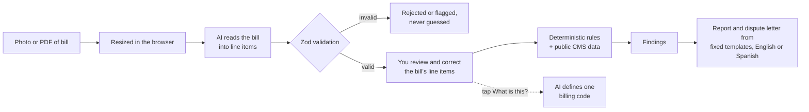

# Unbundle

Unbundle audits medical bills. You upload a photo or PDF of a bill, it reads the line items, runs fixed, tested checks against public Medicare data, and tells you what is worth asking about in plain English or Spanish. You leave with a report and a letter you can take to the billing office.

**Demo:** `<DEMO LINK PLACEHOLDER>` (the sample bill needs no sign-in)

## The problem

Medical bills are hard to read and harder to check. Duplicate lines, services billed separately that should be billed together, and prices far above what Medicare pays all look the same to someone holding a bill with no way to verify it. Most people pay, or give up, because they cannot tell what is worth disputing and do not know what to say.

## Who it helps

- Patients and families who received a bill they cannot verify, especially people who are uninsured or underinsured, who have the least leverage and the fewest people to ask.
- Spanish-speaking households: the whole app and the dispute letter are available in English and Spanish.
- People who may qualify for financial assistance or a Good Faith Estimate dispute and do not know it.

## How it works

The AI only reads the bill into structured data. It never decides what is wrong. Every finding comes from deterministic code in `src/lib/rules`, and the wording of each finding comes from fixed templates (English and Spanish). The AI has one other job: when you tap "What is this?" on a line, it defines that single billing code in general terms. Only the code is sent for that, never your name, dates or amounts.



Why this split matters: model output is validated against a schema, you can review and correct the bill's line items before the report is produced, and the rules are plain functions with unit tests. Amounts read from an optional EOB are used by two rules but are not shown for editing, so those two findings rest on an unreviewed reading. The same bill and the same data always produce the same findings, with no randomness, no clock and no network access.

## The checks

Ten checks: nine rules that look at the bill, plus an optional Good Faith Estimate comparison for people without insurance. Seven of the nine rules run on every bill. Two (denied, then billed; and balance billing) run only when an EOB is uploaded. The financial assistance estimate is a separate optional step, not a check of the bill.

| Check | What it looks for |
|---|---|
| Duplicate charges | The same service billed more than once on the same day |
| Math errors | Units times price that does not match the amount charged |
| Wrong dates | Charges dated outside the dates of service |
| Unbundling | Services Medicare's NCCI edits say should not be billed together |
| Quantity limits | More units than Medicare's medically unlikely edits (MUE) allow |
| Price outliers | Prices more than 5x the Medicare rate for the same service |
| Vague charges | Lump-sum or unlabeled charges |
| Denied, then billed (needs an EOB) | Lines the insurer denied that were still billed in full |
| Balance billing (needs an EOB) | Bill asks you to pay more than the EOB says you owe for the same service |
| Good Faith Estimate (optional) | Compares an uninsured patient's estimate with the final bill |
| Financial assistance estimate (optional) | Compares household income with HHS poverty guidelines to estimate whether free or discounted care at a California hospital may apply |

Findings are things worth asking about, not certain mistakes.

## Accuracy

Each rule was run against the fixture bills and compared with the findings expected for them (`npm run accuracy`, source `src/lib/accuracy/accuracy.json`, full method in [docs/accuracy.md](docs/accuracy.md)).

| Rule | TP | FP | FN | Precision | Recall |
|---|---:|---:|---:|---:|---:|
| duplicate_charge | 1 | 0 | 0 | 100% | 100% |
| math_error | 1 | 0 | 0 | 100% | 100% |
| date_mismatch | 1 | 0 | 0 | 100% | 100% |
| ncci_unbundling | 2 | 0 | 0 | 100% | 100% |
| mue_exceeded | 1 | 0 | 0 | 100% | 100% |
| price_outlier | 1 | 0 | 0 | 100% | 100% |
| vague_charge | 1 | 0 | 0 | 100% | 100% |
| denied_billed_in_full | 1 | 0 | 0 | 100% | 100% |
| balance_billing | 1 | 0 | 0 | 100% | 100% |
| **overall** | 10 | 0 | 0 | 100% | 100% |

**Read this honestly.** These numbers come from **16 synthetic fixture bills** that I wrote alongside the rules, 6 of them (4 traps and 2 clean bills) designed to catch false alarms. They show the rules behave as designed. They are not a measure of real-world accuracy: every rule has only one or two true cases, and real bills are messier. A finding must match on rule, line item IDs and amount at stake to count as correct. The reading step (AI extraction) is not part of this table.

## Data sources

All reference data is public and loaded into Postgres as read-only tables.

| Data | Source | Release |
|---|---|---|
| NCCI procedure-to-procedure edits (practitioner) | CMS | 2026 Q4 |
| NCCI medically unlikely edits (MUE) | CMS | 2026 Q4 |
| Medicare Physician Fee Schedule relative values and GPCI | CMS | RVU26A |
| Poverty guidelines | HHS | 2026 |

## Scope and limits

- NCCI edits are **practitioner** edits only (edit set 1). Hospital outpatient edits are not included.
- Prices and MUE checks cover services on the **Medicare Physician Fee Schedule** only. Hospital facility charges, lab tests and anesthesia are not priced.
- Locality is **Los Angeles** (Medicare locality 18, MAC 01182).
- Medicare rates are a yardstick. They are not what a given hospital or insurer must charge.
- Unbundle is not legal or medical advice.

## Privacy

This summary matches the in-app `/privacy` page.

- Your files are stored in a private folder that only your account can read, write or delete.
- Our upload form resizes photos in your browser before they are uploaded, and re-encoding removes image metadata such as location. This happens in the browser; the server does not enforce it.
- Your files are sent to Anthropic's API only so your bill can be read. Anthropic's published terms say that, by default, your bills are not used to train its models and API data is deleted within 30 days. Those are Anthropic's terms, not ours.
- Deleting a bill removes the bill, its line items and the uploaded files from our storage. A record that a reading was attempted (user id and timestamp, no bill content) is kept until you delete your account.
- There is no retention period: bills and files are kept until you delete them.
- We never sell your information. Data is processed by Anthropic (reading the bill), Supabase (database and storage), Google (sign-in) and the web host.
- The sample bill is made up. No real bills are in this repository, and bill contents are never logged.

## Tech stack

Next.js (App Router) and TypeScript, Tailwind and shadcn/ui, Supabase (Google auth, Postgres with row-level security, storage), the Anthropic SDK (extraction and explanations only), Zod at every external boundary, next-intl (English and Spanish), `@react-pdf/renderer` for the report and letter, Vitest for tests.

## Setup

Requirements: Node 20+, a Supabase project, an Anthropic API key (optional in mock mode).

```bash
npm install
# create .env.local; see docs/DEPLOY.md for the full list of variables
npm run dev
```

- With `EXTRACTION_MODE` unset the app uses a mock extractor, so the sample bill and the whole flow work without an Anthropic key. Set `EXTRACTION_MODE=anthropic` with `ANTHROPIC_API_KEY` for real extraction.
- Apply `supabase/migrations/0001` to `0005` in order, then import reference data with `node scripts/import-reference.mjs` and `node scripts/import-poverty.mjs --confirm` (needs the service role key locally). In production the service role key is set in exactly one place, for account deletion (`src/lib/account/admin.ts`); see [docs/DEPLOY.md](docs/DEPLOY.md).
- Deployment, Auth and Google OAuth setup: [docs/DEPLOY.md](docs/DEPLOY.md).

Useful commands:

| Command | What it does |
|---|---|
| `npm run dev` / `npm run build` | Run or build the app |
| `npm test` | Unit and component tests (Vitest) |
| `npm run lint` and `npx tsc --noEmit` | Lint and type check |
| `npm run accuracy` | Regenerate the accuracy table (needs `.env.local`) |
| `npm run check:contrast` | Colour contrast guard |
| `npm run test:e2e` | Browser smoke test of the signed-out demo flow (see [docs/e2e.md](docs/e2e.md)) |

## What I would do next

- Test on real, de-identified bills with consent and measure extraction accuracy, not just rule accuracy.
- Add hospital facility edits and outpatient pricing, which is where much of the money is.
- Cover more Medicare localities than Los Angeles.
- Add more languages and a reading-level pass on every explanation.
- Have a billing advocate or patient-rights organisation review the checks and the letter wording.
- Add a CPT/HCPCS reference note on every finding so the user can look up the code themselves.
